# Part 1. Exploratory Data Analysis

Group 3

## Dataset scope and coverage

We compared 119,390 bookings at a Lisbon city hotel and an Algarve resort to see how demand changed through the year. Arrivals ran from July 2015 to August 2017, making 2016 the only complete year. We therefore compared the hotels month by month, since annual totals would give 2016 an advantage simply because it covers more months. We grouped the 32 fields (15 categorical and 17 numerical) by what they tell us about the guests, their stay and the booking itself (Figures 1–4).

## Data cleaning criteria

When we added up the adults, children and babies on each booking, we found 180 with nobody listed, so we excluded them. We also removed a negative nightly rate (−6.38), a rate of 5,400 above our 5,000 cutoff, and two bookings listing nine or more babies, which we judged to be recording errors. Five more had a missing child count or an undefined market segment or booking channel. Removing these 189 rows left 119,201 bookings (Figure 5).

A missing entry meant different things depending on the field. We recorded “No agent” or “No company” when no intermediary was listed and treated 1,169 undefined meal entries as “No meal package”. For 478 bookings we had no way to establish the guest’s country, so we used “Unknown”. We interpreted CN as Canada in 1,279 bookings because China already appeared as CHN and Canada was otherwise absent, although the records cannot confirm that assumption.

We kept unusual entries that could represent real bookings, including zero prices, zero nights, children booked without adults, large groups and 27 check-out date discrepancies. Of the original rows, 31,994 repeated an earlier row exactly. Without a booking identifier, we could have erased separate reservations by removing every match, so we kept the 31,980 repeats that remained after cleaning.

## Booking patterns and analytical decisions

Looking at how far ahead people booked, we saw that a few very early reservations pulled the mean up to 104 days. We chose the median of 69 days because it better describes a typical booking (Figure 6). Most stays lasted one to four nights, with peaks at one and two weeks, and Portugal accounted for 40.7% of bookings (Figures 7–8). Prices varied most at the resort, where the median nightly rate rose from 46.8 in November to 180.4 in August (Figures 9–10).

In the raw data, 37.0% of bookings were cancelled, but the rate ranged from 9.6% for bookings made within a week of arrival to 67.7% for those made more than a year ahead. For non-refundable bookings it reached 99.4%, a figure repeated entries may have inflated (Figure 11). We therefore kept booking lead time alongside cancellations, and calculated the arrival date, total guests and total nights for each booking so we could compare demand by hotel, country and price. We left final reservation status out of any prediction because it already tells us whether the booking was cancelled. These findings describe a historical period. For current planning, we would need fresh bookings daily or monthly, depending on the decision.

## Figures

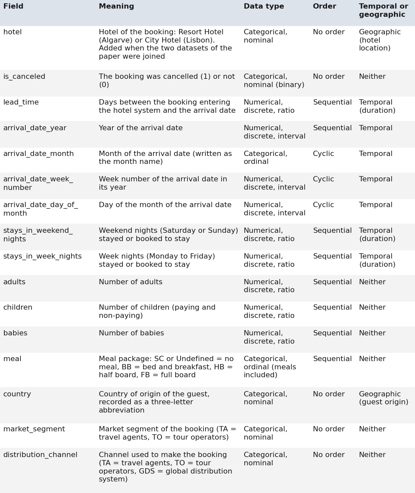

*Figure 1. What fields 1–16 measure and how we classified them.*

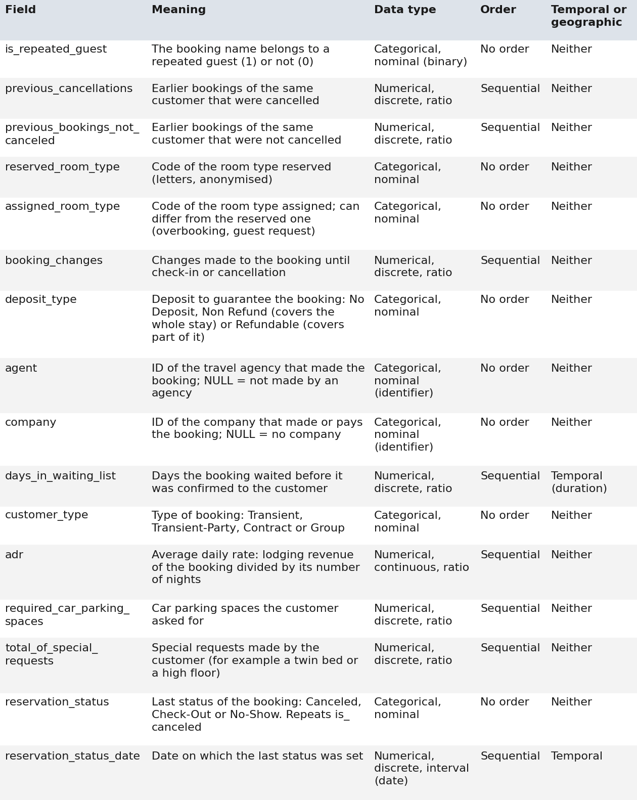

*Figure 2. What fields 17–32 measure and how we classified them.*

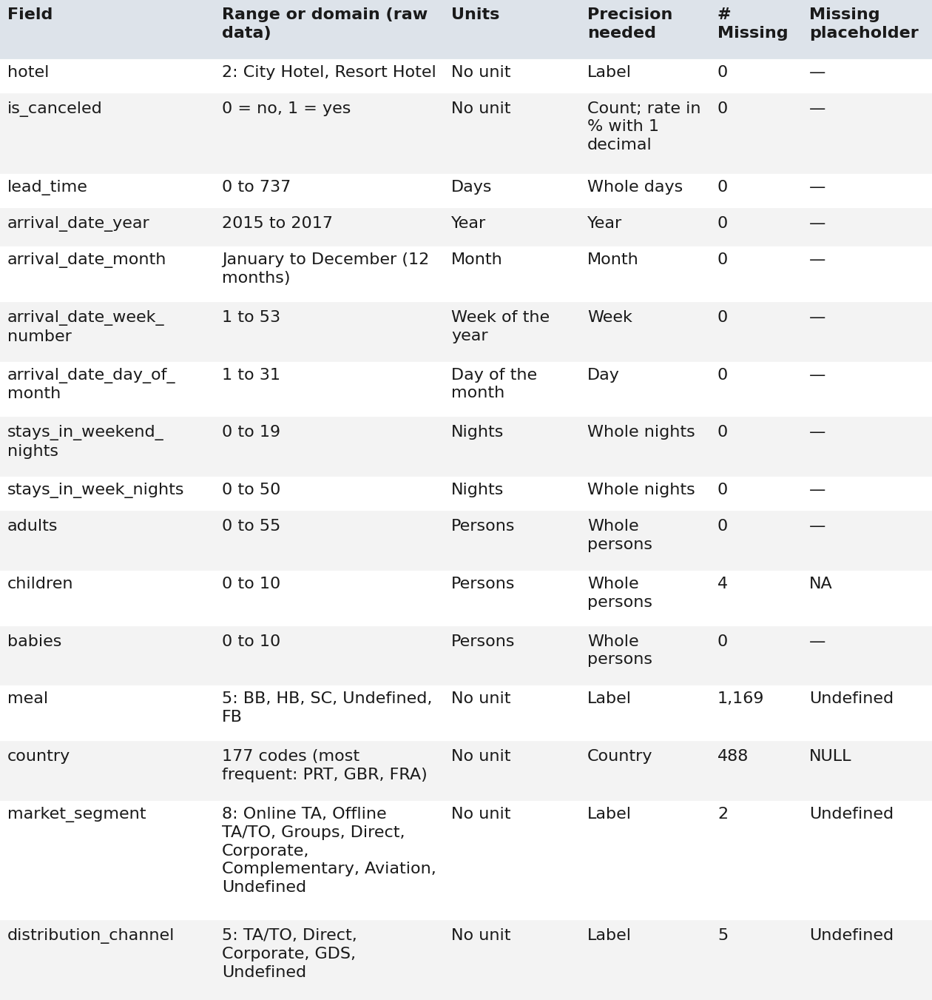

*Figure 3. Values, units, precision and missing entries for fields 1–16.*

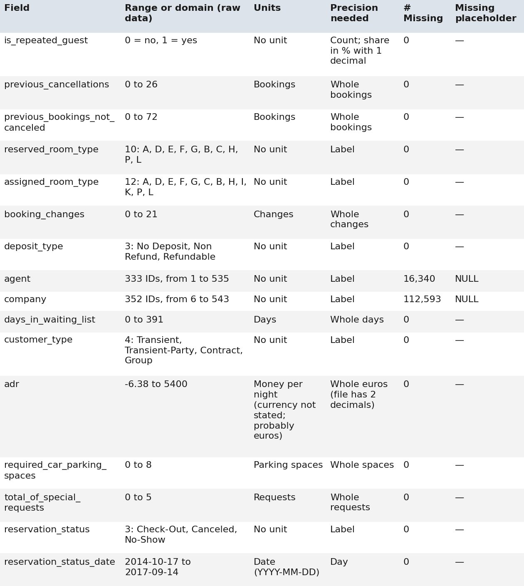

*Figure 4. Values, units, precision and missing entries for fields 17–32.*

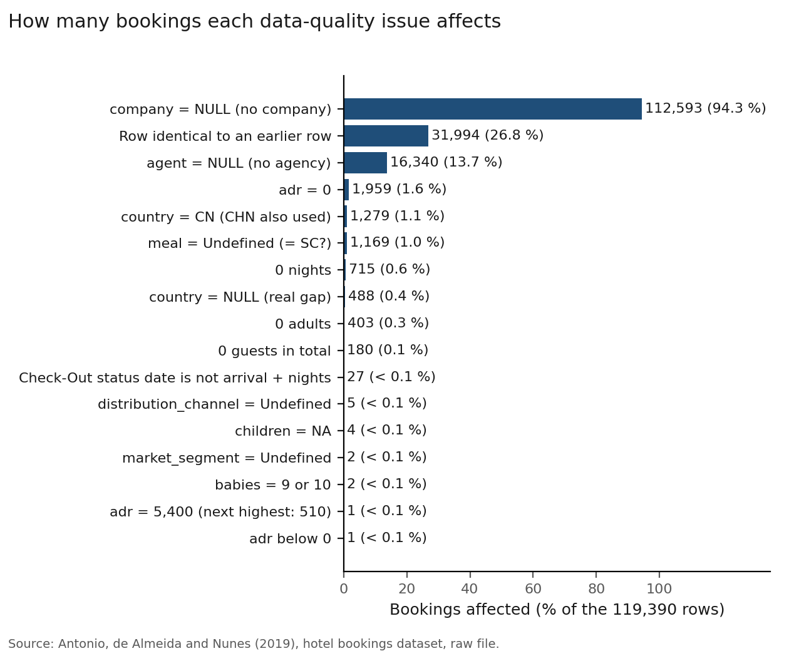

*Figure 5. Bookings affected by each data quality issue.*

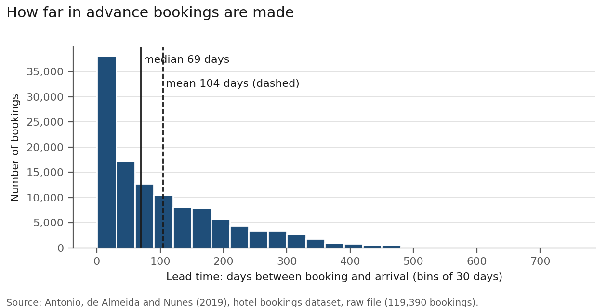

*Figure 6. Days between booking and arrival. Early bookings pull the mean above the median.*

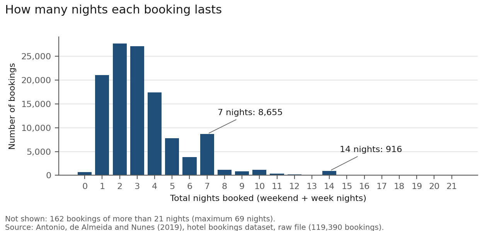

*Figure 7. Nights per booking. Stays cluster at seven and fourteen nights.*

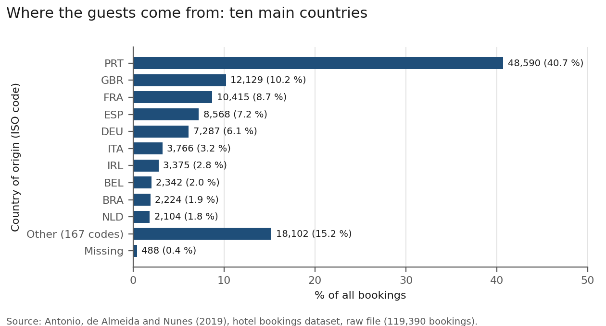

*Figure 8. The ten most frequent countries of origin in the booking records.*

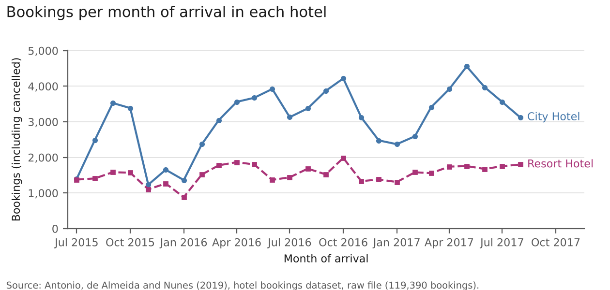

*Figure 9. Monthly bookings at the city hotel and the resort.*

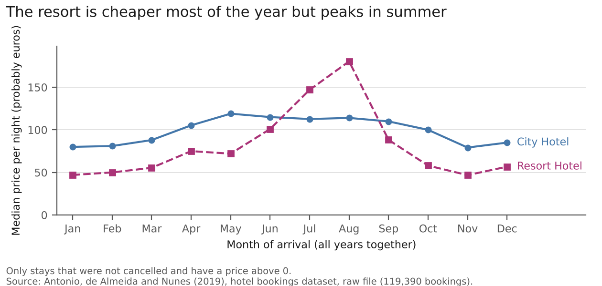

*Figure 10. Median nightly rate by month at each hotel.*

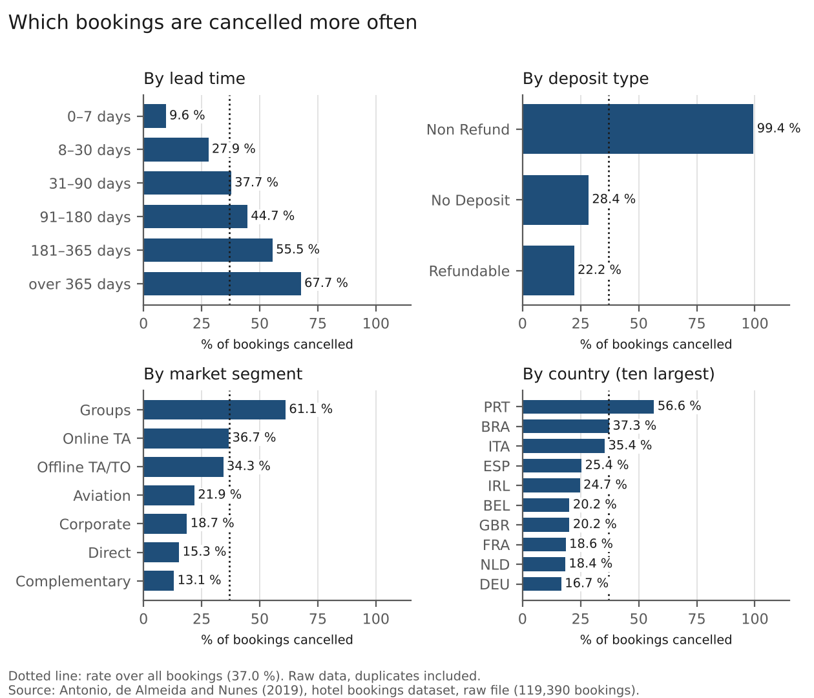

*Figure 11. Cancellation rates by booking lead time, deposit, market segment and country.*

## Data source

Antonio, N., de Almeida, A. and Nunes, L. (2019). Hotel booking demand datasets. *Data in Brief*, 22, 41–49. https://doi.org/10.1016/j.dib.2018.11.126
