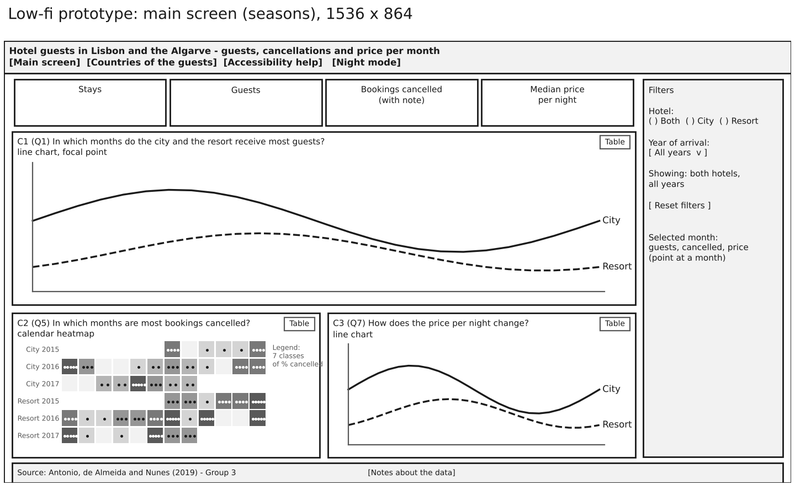
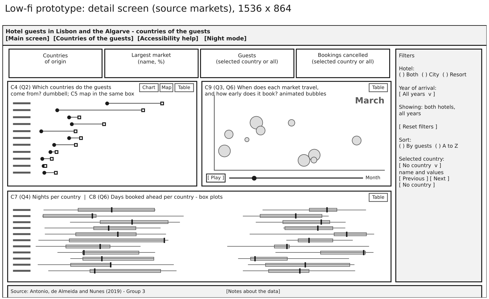
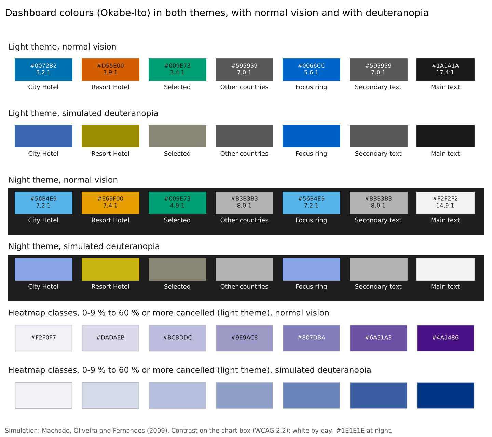

# Part 4. Selection of Charts and Encoding

Group 3

## Seasonal demand

To compare the hotels’ busy seasons, we plotted monthly guest numbers on the same axes. We gave this chart 46% of the main screen so the peaks in the two lines are easy to compare (Figure 1). We used the same timeline for nightly rates, from July 2015 to August 2017, because only 2016 has a full year of observations. For cancellations, we gave each hotel and year its own row in a calendar heatmap. August always falls in the same column, making it easy to compare that month across hotels and years.

| Question | Chart | What we show |
|---|---|---|
| Q1. Busiest months | Line chart | Monthly guest numbers for each hotel |
| Q5. Cancellations | Calendar heatmap | Percentage of bookings cancelled each month |
| Q7. Nightly rate | Line chart | Median price per night for each hotel |
| Q2. Guest origins | Paired dots or map | Each country’s share of guests at each hotel |
| Q3. Travel season | Animated bubbles | Monthly arrivals and booking lead time by market |
| Q4. Length of stay | Box plots | Median and spread of nights per stay |
| Q6. Booking lead time | Box plots | Median and spread of days booked ahead |

## Guest origins and travel habits

On the detail screen, we put the two hotels’ dots on the same row for each market. If the dots sit close together, that country accounts for a similar share of guests at both hotels. The same space can display a map when the question is where those markets are located (Figure 2).

In the animation, each bubble represents a market. As the months advance, its position shows how far ahead guests booked and what share of that market’s annual guests arrived that month, while its size shows the guest count. We placed the box plots side by side to show, for example, whether guests from one market tend to stay a similar number of nights even when they book at very different times. This gives the detail screen three chart areas, the largest taking 39% of the available space, just below our 40% target.

## Colour and readability

Where the two hotel lines cross, their colours can be hard to distinguish. We gave each hotel a distinct line style, point shape and label as well as its own colour, blue for the city hotel and vermilion for the resort. We used the same cues on both screens. Denser dots mark higher cancellation rates on the heatmap’s seven purple shades. An outline, stripes or a bold label identifies the selected country alongside its green highlight. Each chart also has a table for exact values.

We checked both themes with simulated deuteranopia (Figure 3). All data colours reached a contrast ratio of at least 3 to 1 against their backgrounds. The charts passed the applicable DRACO design checks, and we reviewed the map separately.

## Figures

*Figure 1. Our main screen layout at 1536 × 864 pixels.*

*Figure 2. Our layout for exploring guest origins and comparing markets.*

*Figure 3. Hotel colours and heatmap shades in light and night mode, including simulated deuteranopia.*
