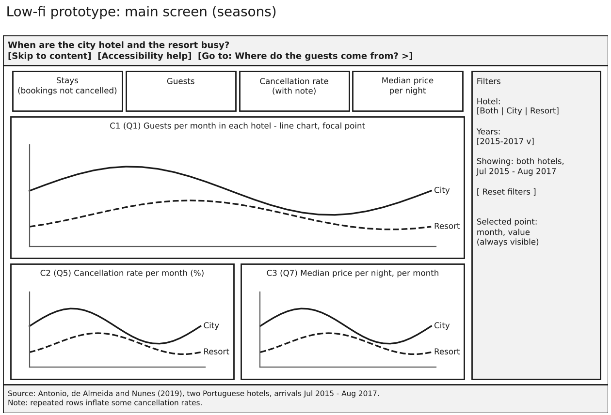
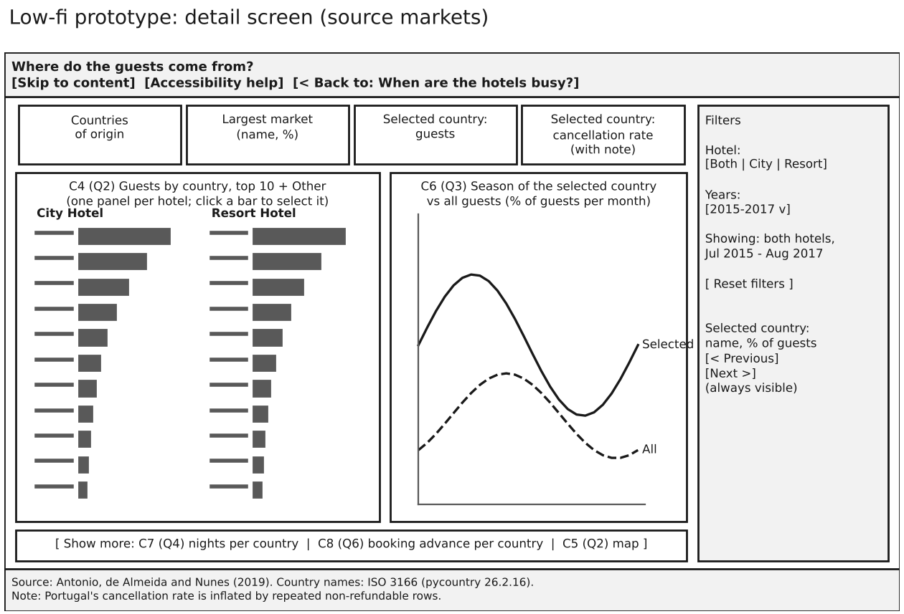
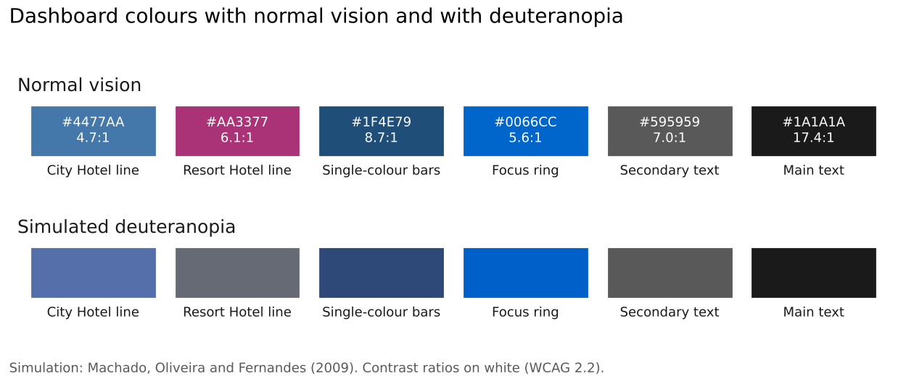

# Part 4. Selection of Charts and Encoding

Group 3, Presentation and Visualization, Infovis2627

## Charts for each question

Each chart answers one of Natalia's questions and was chosen by its function in the Visual Vocabulary. Every chart passes the DRACO hard rules that apply to it; the map is outside DRACO and is judged with the course's GeoHandout.

| Question | Function | Chart |
|----------------|----------------|----------------------------------------|
| Q1 busiest months | Evolution over time | C1 line chart of guests per month, July 2015 to August 2017, one line per hotel |
| Q5 cancellations | Evolution over time | C2 line chart of the cancellation rate per month |
| Q7 price | Evolution over time | C3 line chart of the median price per night per month |
| Q2 countries | Ranking, spatial | C4 sorted horizontal bars, top 10 countries and Other, one panel per hotel; C5 small map |
| Q3 season per market | Evolution over time | C6 line chart of the selected country's guests per month against all guests |
| Q4 length of stay | Magnitude | C7 sorted bars of median nights per country |
| Q6 booking advance | Magnitude | C8 sorted bars of median lead time per country |

C1 to C3 use the full timeline instead of pooled calendar months, because only 2016 is complete; C6 pools months, but it compares a country with all guests over the same months, so the extra July and August weigh on both lines alike. Bars start at zero and are sorted, so position and length, the most accurate channels, carry every value, and medians are used because the data is skewed.

## Encoding, colour and accessibility

The two hotels use blue and purple from Paul Tol's bright palette (Figure 3). Both pass the 3:1 contrast for graphics, but with Natalia's deuteranopia they are almost equally light, so each hotel also has its own line style, point shape and a direct label at the end of its line: redundant coding (Ware G5.11) and Gestalt proximity replace the legend. Bars use a single dark blue, so no fill patterns are needed. C2 and C3 repeat the time axis of C1 directly below it, so a month is read in the same place in the three charts (Gestalt proximity and similarity), and the country panels share one scale, so the hotels are compared by position. All 28 items of our accessibility plan were reviewed: twelve are solved by this design and the rest are planned for Parts 5 and 6.

## Prototype

Both screens share one frame (Figures 1 and 2): title, skip and help links, four KPIs, a filter panel on the right with the active filters and a reset button, and a footer with the source and the duplicates note. The main screen answers Q1, Q5 and Q7 with C1 as its focal point, taking 46 % of the content area. The detail screen answers Q2 and Q3 with C4 and C6; Q4, Q6 and the map wait behind "Show more", so no screen shows more than three charts, following the cognitive accessibility limits.

## Figures

*Figure 1. Low-fidelity prototype of the main screen, 1280 × 800 px. Source: our design; code: lowfi_prototype.ipynb.*

*Figure 2. Low-fidelity prototype of the detail screen. Source: as Figure 1.*

*Figure 3. Dashboard colours with normal vision and simulated deuteranopia. Source: encoding_checks.ipynb.*
