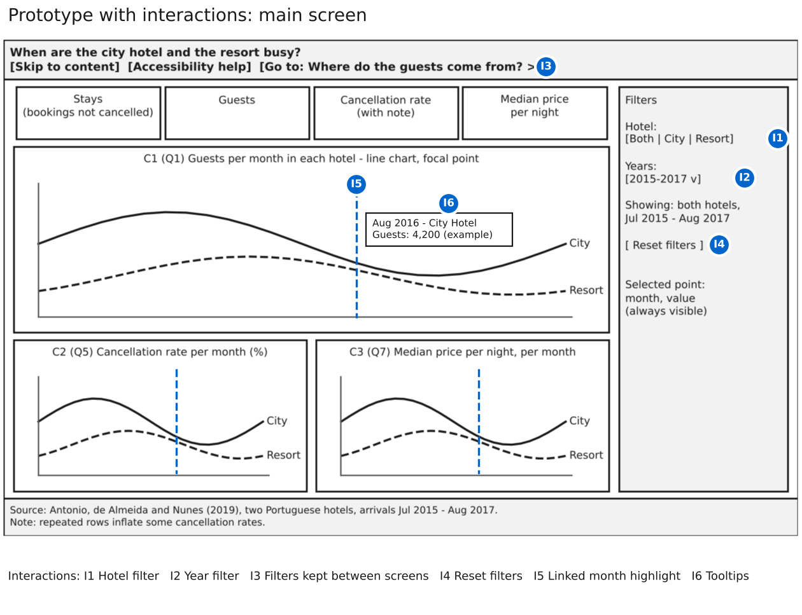
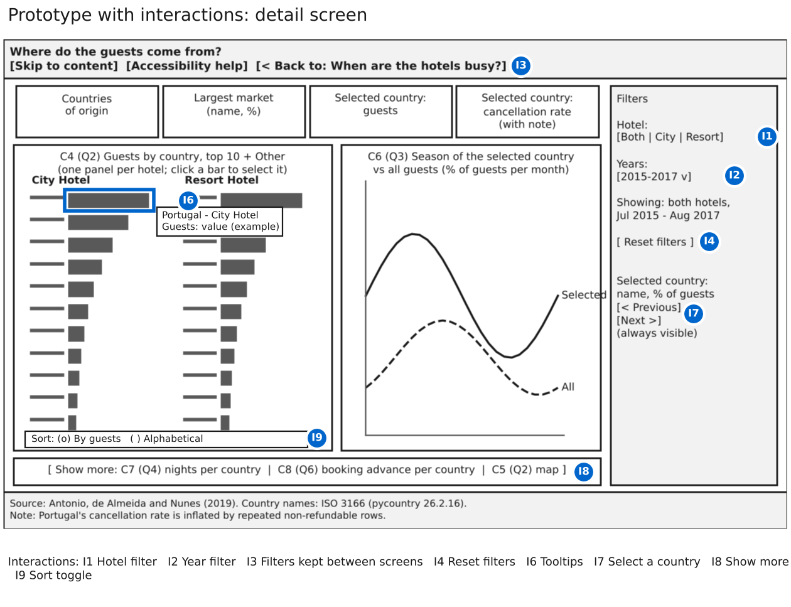

# Part 5. Interaction Planning

Group 3, Presentation and Visualization, Infovis2627

## Principles

Interaction lets Natalia choose what to see, but every action has a cognitive cost (course 07). We therefore added only interactions that serve her seven questions, followed Shneiderman's mantra ("overview first, zoom and filter, then details on demand") and gave each one a keyboard equivalent. Both screens open with data already visible: both hotels, the whole period and, on the detail screen, Portugal selected. Zoom, pan and drag were rejected because the line and bar charts show at most 26 months or 11 country groups, and the map is only a small secondary view.

| # | Interaction | Course type | Mantra step |
|----|---------------------------|--------------------------|----------------|
| I1 | Hotel filter | Manipulation: filter | Zoom and filter |
| I2 | Year filter | Manipulation: filter | Zoom and filter |
| I3 | Filters kept between screens | Exploration: navigation | Overview first |
| I4 | Reset filters | Manipulation: filter | Zoom and filter |
| I5 | Linked month highlight | Problem solving: linked views | Details on demand |
| I6 | Tooltips | Problem solving: details on demand | Details on demand |
| I7 | Select a country | Problem solving: linked views | Details on demand |
| I8 | Show more | Problem solving: overview and detail | Details on demand |
| I9 | Sort toggle | Manipulation: order | Zoom and filter |

## Interactions between charts

The hotel and year filters (I1, I2) act on all KPIs and charts of a screen, and the link to the other screen carries them (I3), so Natalia does not have to remember and repeat her choice. The year labels name the partial years, "2015 (Jul–Dec)" and "2017 (Jan–Aug)", so they are not compared with 2016 by mistake. A reset button (I4) is always visible. On the main screen, pointing at a month or moving to it with the arrow keys draws a rule at that month in the three charts (I5), relating guests, cancellations and price of the same month. On the detail screen, selecting a country with a click, the arrow keys or the Previous and Next buttons (I7) updates its season line, the KPIs and the hidden charts; the selected bar gets an outline and its name and value are written beside the chart, so colour is not the only cue.

## Interactions inside each chart

Tooltips (I6) give exact formatted values with units on every chart, also with Enter or Space on a focused point. The sort toggle (I9) reorders the country bars by guests or alphabetically. "Show more" (I8) reveals the length of stay, booking advance and map, keeping at most three charts visible.

## Feasibility

Every chart feature was built in a small Vega-Altair test and compiled to SVG. Because each chart is embedded separately, with its own alternative text, selections are passed between charts with a few lines of JavaScript, built and tested in Part 6. Figures 1 and 2 show where each interaction appears.

## Figures

*Figure 1. Main screen with interactions I1 to I6. Source: our design; code: prototype_interactions.ipynb.*

*Figure 2. Detail screen with interactions I1 to I4 and I6 to I9. Source: as Figure 1.*
