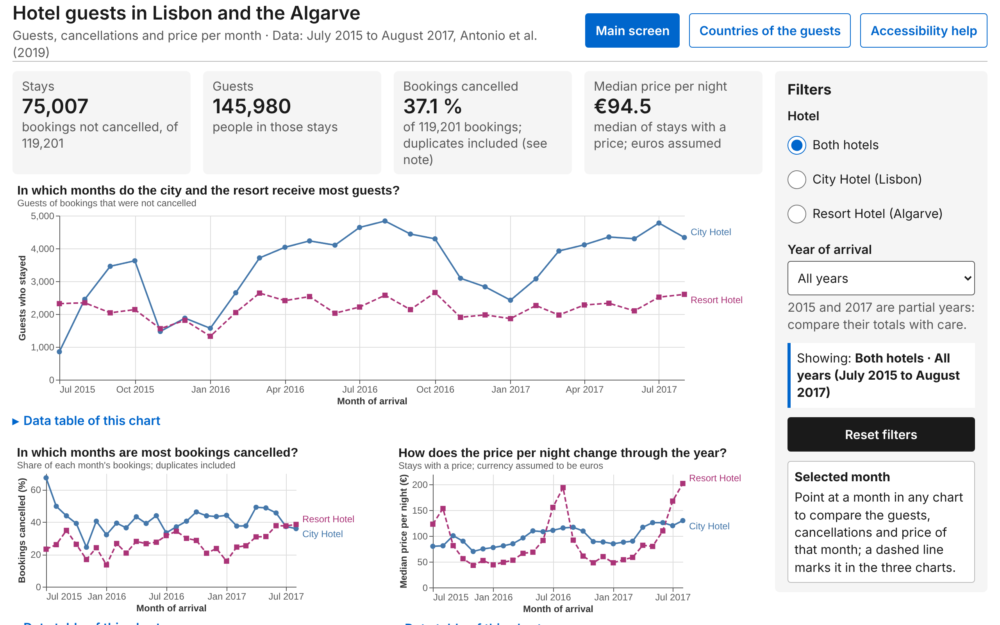
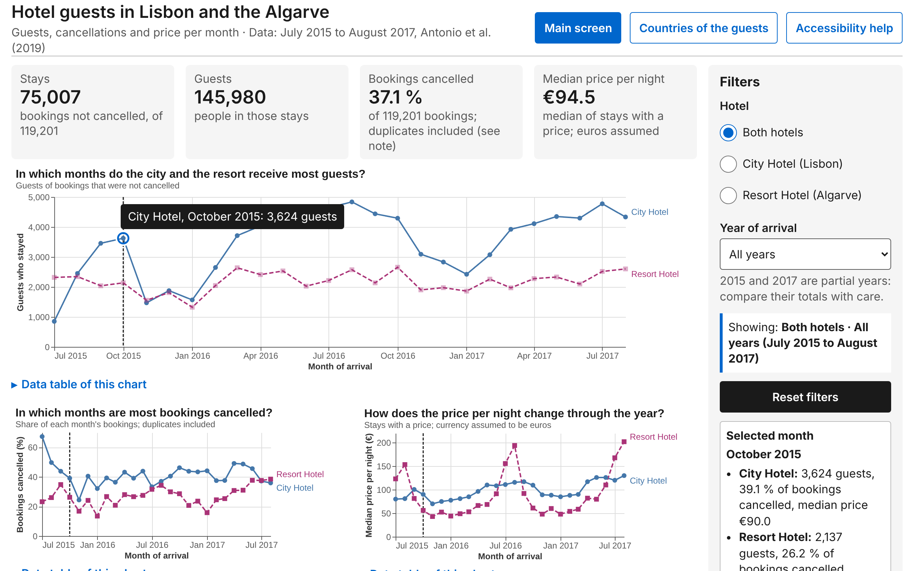
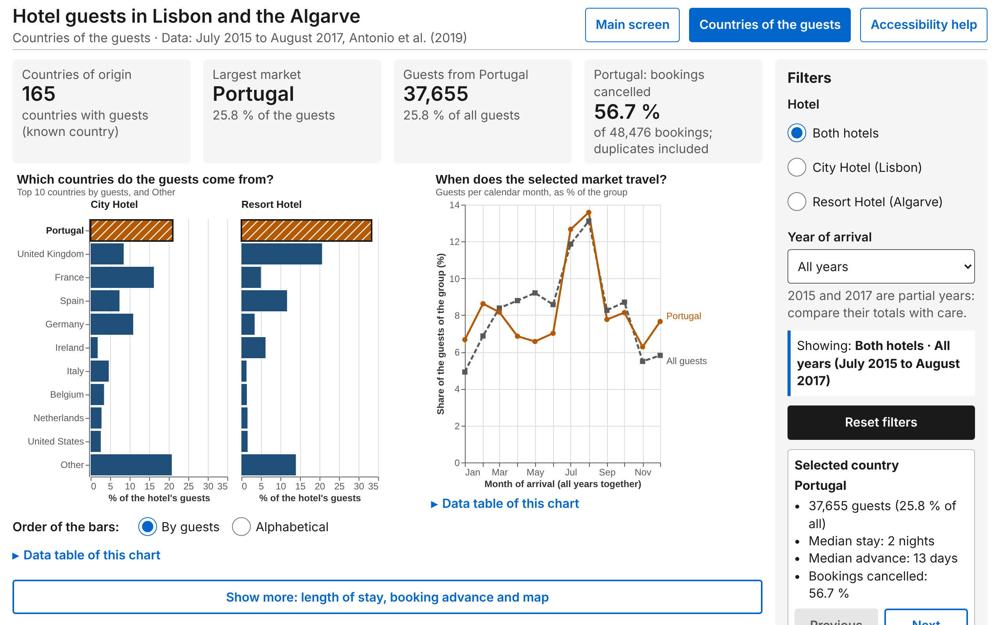
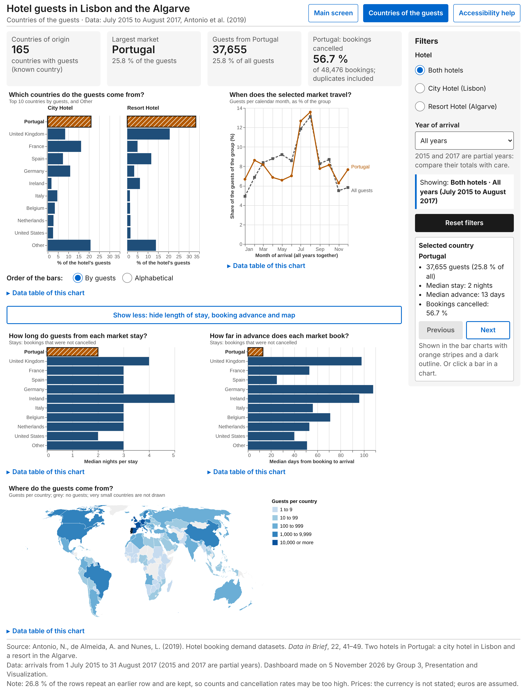

# Part 6. Implementation and Delivery

Group 3, Presentation and Visualization, Infovis2627

## How to open the dashboard

Open the folder `Part 6 - Implementation and Delivery/dashboard/` and double-click `index.html`, or open it in any web browser or in VS Code. No server, no command and no internet connection are needed: the data, the chart specifications and the Vega libraries are all local files in that folder. The main screen opens first; the link "Countries of the guests" in the header leads to the detail screen, and "Accessibility help" leads to `accessibility.html`, which explains how to use both screens with the keyboard and a screen reader.

## What was built

The dashboard has the two screens planned in Part 4 for Natalia, the tourism analyst of Part 2. The main screen (Figure 1) is the overview: four key figures and three line charts that answer when the city hotel and the resort receive guests (Q1), when bookings are cancelled (Q5) and how the price per night changes (Q7). The detail screen (Figures 3 and 4) answers where the guests come from (Q2), when each market travels (Q3), how long it stays (Q4) and how far in advance it books (Q6). Both screens share one frame: title, a subtitle with the data period and source, four key figures, a filter panel on the right with the active filters and a reset button, and a footer with the full citation, the date and the data notes.

The work is split into three notebooks in `code/`. `build_dashboard.ipynb` prepares the data with pandas, builds the eight charts with Vega-Altair and writes `data.js` and `specs.js` straight into `dashboard/`. `browser_checks.ipynb` opens the pages from the folder, exactly as the professor will, and tests them in a headless browser. `final_review.ipynb` gathers every check, reviews the four checklists of the course skills and takes the screenshots in `images/`. Each notebook was saved after "Restart and run all", in that order, with no errors.

## Data preparation

The dashboard never draws the 119,201 cleaned bookings of Part 1. The notebook aggregates them with pandas into five small tables, from 12 to 586 rows and about 52 KB in total, saved in `data/processed/`. The aggregation level was chosen so that every interaction of Part 5 still works: every table keeps the hotel and the arrival year, so the filters can act on it, the monthly tables keep one row per month, so a month can be linked across charts, and the country tables keep the ten largest markets and "Other" (the map table keeps every country). Medians cannot be added up, so the median price, length of stay and booking advance are computed in advance for each of the 12 combinations of hotel and year filter. Every table was checked against the cleaned data and adds up to its totals: 119,201 bookings, 75,007 stays and 145,980 guests.

One decision changes what Natalia sees. The country charts count guests of stays that were not cancelled, not bookings, because she plans campaigns for the people who actually travel. With this measure Portugal falls from 40.7 % of the bookings to 25.8 % of the guests, since Portuguese bookings are cancelled much more often (56.7 %).

## Charts

Every chart was chosen in Part 4 by its function in the Visual Vocabulary and built in Vega-Altair with a plain-language title phrased as Natalia's question, a subtitle, axis titles with units, formatted tooltips, an explicit colour scale and a `description` that becomes its alternative text. The charts are drawn as SVG, never canvas, as the accessibility skill requires. Bars start at zero and are sorted, so position and length, the most accurate visual channels, carry every value.

The two hotels use blue (#4477AA) and purple (#AA3377) from Paul Tol's bright palette. With Natalia's deuteranopia they look almost equally light, so each hotel also has its own line style (solid or dashed), point shape (circle or square) and a direct label at the end of its line: this is redundant coding (Ware), and the direct labels replace a legend, using Gestalt proximity. The three charts of the main screen share the same time axis, so a month is read in the same place in all of them (Gestalt similarity), with the guests chart as the focal point of the screen, as the course on dashboards recommends. On the detail screen the bars are one dark blue (#1F4E79), and the selected country is shown in dark orange (#B35900), with white stripes, a dark outline, a bold axis label and its values written in the "Selected country" box, so colour is never the only cue. The world map uses five named classes of a sequential blue scale, because the number of guests is ordered. Following the GeoHandout, its scale and projection were chosen on purpose: a TopoJSON world map at 1:110 million, small enough for the page, drawn with the Equal Earth projection, which, unlike Mercator, keeps the areas of the countries comparable.

Each chart was checked by code against the DRACO hard rules on its real specification: 197 checks on the eight charts, all passed (the map is outside DRACO and was judged with the GeoHandout). The values drawn by Vega were also compared with the pandas tables for all 12 filter combinations: 624 marks on the main screen and 2,346 on the detail screen, all equal.

## From the notebook to the pages

The pages are plain HTML, CSS and JavaScript around the Altair charts, because the keyboard navigation, focus rings and announcements required by the accessibility skill cannot be produced by Altair alone. The skills load the data as a `data.json` file, but browsers block reading a local `.json` file from a page opened by double-click. The notebook therefore writes the data as `data.js` (255 KB, including the world map) and the chart specifications as `specs.js` (34.5 KB), and the pages load them with `<script src>`. The data and the specifications stay out of the HTML, as the skills ask. Local copies of Vega 6.2.0, Vega-Lite 6.4.1 and vega-embed 7.1.0, with their BSD-3-Clause licences, are in `dashboard/lib/`, so the dashboard also works offline. The style and the code shared by both screens are in `dashboard.css` and `dashboard.js`, two files more than the list in `architecture.md`, so the two screens cannot drift apart.

The layout follows the Part 4 grid for a 1280 × 800 px screen and the cognitive accessibility limits: at most four key figures and three charts visible at once. On the detail screen the length of stay, the booking advance and the map wait behind a "Show more" button (overview and detail).

## Interaction

All nine interactions of Part 5 were implemented and follow Shneiderman's mantra. The main screen is the overview. The hotel and year filters (I1, I2) update the key figures, the charts and the "Showing" line, and the link to the other screen carries them (I3); the year options name the partial years, so 2015 and 2017 are not compared with 2016 by mistake, and the reset button (I4) is always visible. Pointing at a month, or moving to it with the arrow keys, draws a dashed rule at that month in the three charts and writes the guests, cancellations and price of that month in the "Selected month" box (I5, linked views). Tooltips (I6) give the exact value with its unit. On the detail screen a country is selected by clicking a bar, with the arrow keys or with the Previous and Next buttons (I7); its season line, the key figures and the hidden charts follow. "Show more" (I8) reveals the three extra charts, and the sort toggle (I9) orders the bars by guests or alphabetically, keeping "Other" last. Every change is announced to screen readers through a polite live region.

Two problems were solved on the way. Vega-Lite 6.4.1 wrote "undefined" for the hotel in the tooltip of its nearest-point selection, so the selection was moved to an invisible copy of the points. Vega did not reorder the bars when the sort order changed, so the three bar charts are drawn again instead. The browser checks test every interaction in both screens: 32 checks, all passed.

## Accessibility

Each chart is one Tab stop; inside it the arrow keys move from point to point, Alt with the up or down arrow changes hotel, panel or line, Home and End jump to the ends, and Enter and Escape show and hide the exact value next to the mark. A blue-and-white ring drawn above the chart marks the focused point, the other series are dimmed, and each move is announced with its position and value. Every chart is in a figure with a short alternative text, a long text with its main values for the current filters, and a collapsible data table. Two skip links, a visible focus on every control, `lang="en"`, valid HTML and the reduced-motion setting complete the WCAG 2.2 AA layer, and the help page lists the keys and gives the course's virtual campus as the contact for problems.

These features were tested in a browser with the keyboard only (37 checks) and the text alternatives in four filter states (18 checks), all passed. The 345 visible texts of the three pages were measured: the lowest contrast is 4.70:1, above the 4.5:1 of WCAG AA, every page text is at least 16 px and every chart text at least 12 px. At 200 % zoom and at tablet widths (1024 × 768 and 768 × 1024 px) the filters move under the charts and the page never scrolls sideways; the main chart keeps its size and scrolls inside its own box, which WCAG allows for two-dimensional content.

## Review and limitations

In the final review all DRACO hard rules pass, the data-viz and notebook checklists are met, and the WCAG and cognitive-accessibility checklist is met, with the adaptations decided in `architecture.md`: `data.js` instead of `data.json`, and a dashboard for a computer or a tablet only, so the phone items do not apply. After seeing the screenshots, the students raised all page text to 16 px, as planned in Part 4, and kept the screen links of the header on one line.

Some limitations remain. The data points are about 8 px, below the 24 px target size of WCAG 2.2, but every point can also be reached with the keyboard and every country with Previous and Next. The dashboard has not been tested with a real screen reader; only the page structure, the live regions and the keyboard were checked in a headless browser. With 16 px text, the Previous and Next buttons of the detail screen are just below the bottom of an 800 px high window. In the data, 26.8 % of the rows repeat an earlier row and are kept, so counts and cancellation rates may be too high; the currency of the price is not stated and euros are assumed; and the country code CN is taken as Canada. The first two are written in the footer of both screens.

## Figures

*Figure 1. Main screen at first load, both hotels and all years, 1280 × 800 px. Source: dashboard/index.html; screenshot: final_review.ipynb.*

*Figure 2. Main screen used with the keyboard, with the focus ring and the value box on a data point. Source: as Figure 1.*

*Figure 3. Detail screen at first load, with Portugal selected. Source: dashboard/detail.html; screenshot: final_review.ipynb.*

*Figure 4. Detail screen with "Show more" open, whole page. Source: as Figure 3.*
