# Part 1. Exploratory Data Analysis

Group 3, Presentation and Visualization, Infovis2627

## The data

The dataset contains 119,390 real bookings of two Portuguese hotels, a resort in the Algarve and a city hotel in Lisbon, with arrivals from July 2015 to August 2017. Each of its 32 fields was classified by meaning (Figures 1 to 4): 15 are categorical (13 nominal, 2 ordinal: month and meal) and 17 numerical (12 discrete ratio counts, 4 discrete interval date parts and the continuous ratio price per night, `adr`). Nine fields are temporal and two geographic.

## Quality

Missing values are written as text. `NULL` in `agent` and `company` means "not applicable", while 488 countries are real gaps. 31,994 rows (26.8 %) repeat an earlier row exactly, and without a booking identifier they cannot be told apart from identical bookings. A few values are impossible (180 bookings without guests, a negative price, a price of 5,400) and `reservation_status` repeats `is_canceled` (Figure 5).

## Distributions

All numeric fields are right-skewed, the median lead time is 69 days but the mean is 104 (Figure 6), so medians describe them better. The resort's prices vary much more, stays peak at 7 and 14 nights (Figure 7), most categorical fields are dominated by one value, Portugal provides 40.7 % of bookings (Figure 8) and many details are rare; the charts not shown here are in `distributions_outliers.ipynb`. The charts follow the course's charts by data type: histograms and box plots for distributions, sorted bars for categories, and small multiples on a common scale (Gestalt similarity) to compare groups.

## Relationships

Bookings and prices follow the season (Figures 9 and 10): the resort's median price rises from 46.8 in November to 180.4 in August. Cancellations (37.0 %) grow with lead time, from 9.6 % to 67.7 %, and are highest for groups (Figure 11). The 99.4 % of non-refundable deposits is probably a recording effect of duplicated blocks. The market mix is similar in both hotels and all correlations are weak, so they are not causes (`relationships.ipynb`).

## Currency and decisions

The data is a closed historical snapshot, about nine years old, with only 2016 complete; it needs no updates, and a live version would need daily or monthly updates depending on the audience. After the approved cleaning rules, 119,201 rows remain. The dashboard will use hotel, arrival date, cancellation, lead time, price, market segment, country, nights, guests, customer and deposit type, highlighting season, cancellations and origin.

## Figures

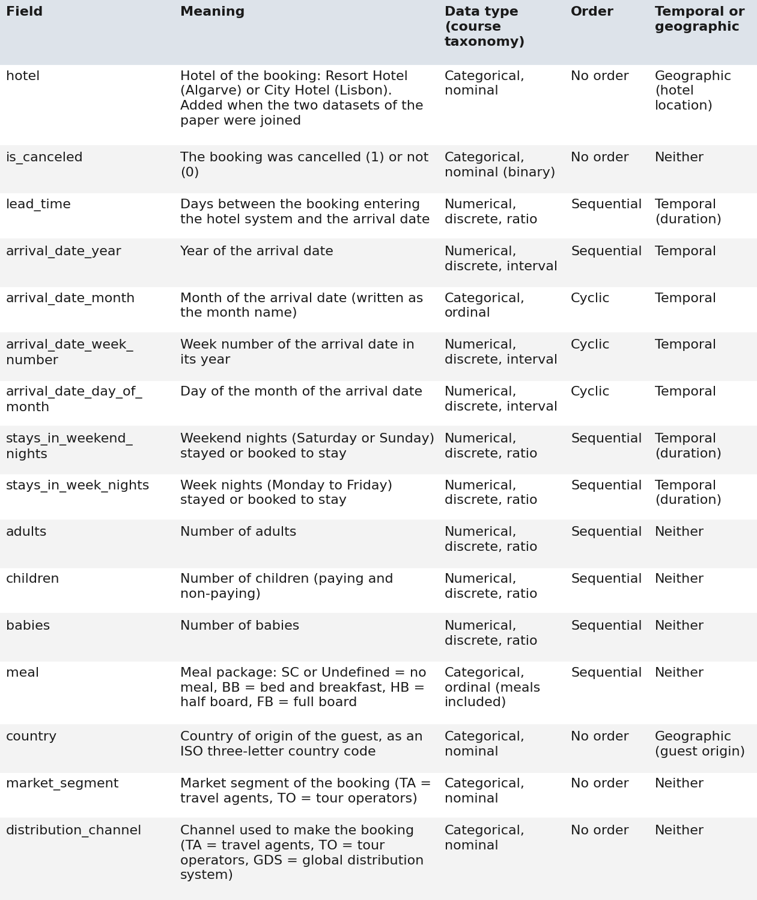

*Figure 1. Data dictionary A (fields 1–16): meaning and data type. Source: Antonio et al. (2019); code: data_dictionary.ipynb.*

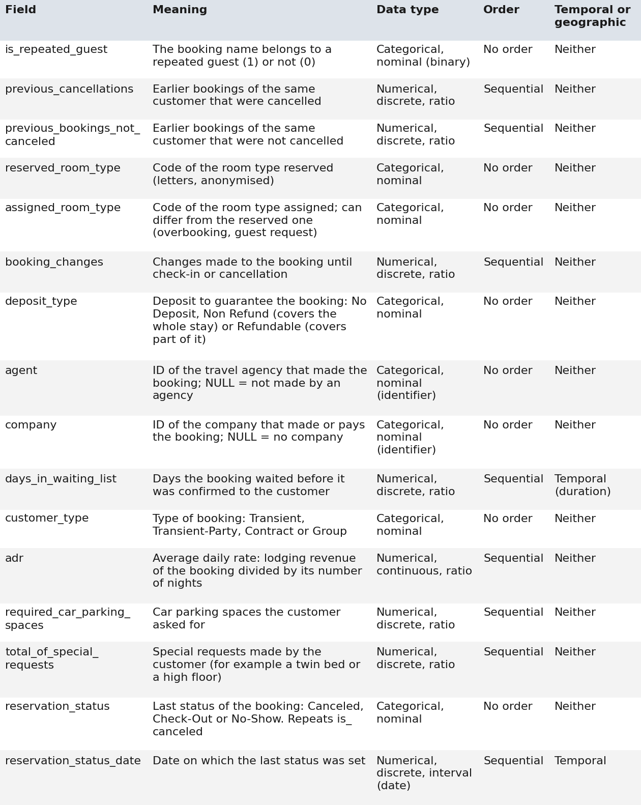

*Figure 2. Data dictionary A (fields 17–32): meaning and data type. Source: as Figure 1.*

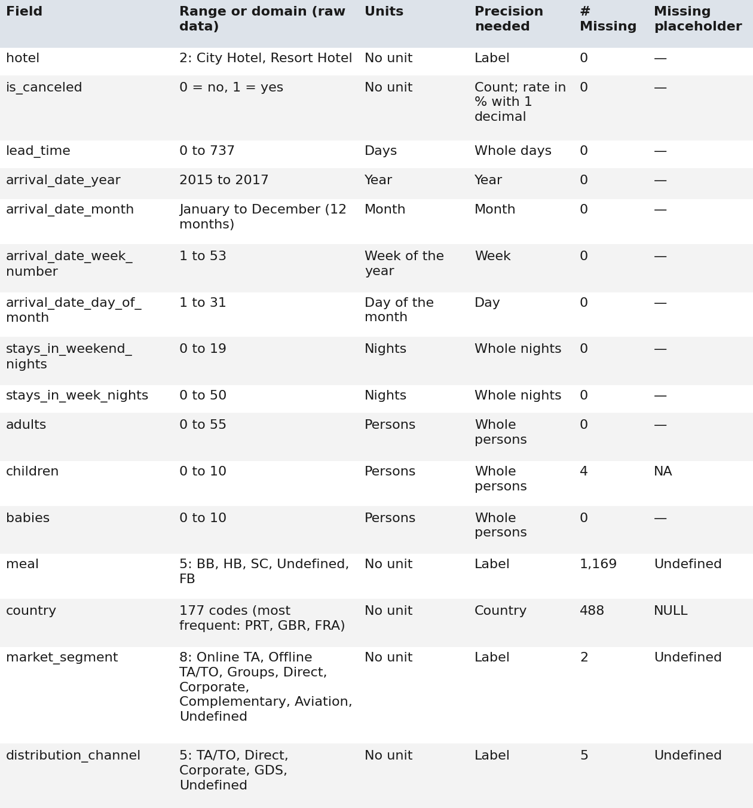

*Figure 3. Data dictionary B (fields 1–16): values, units, precision and missing values. Source: as Figure 1.*

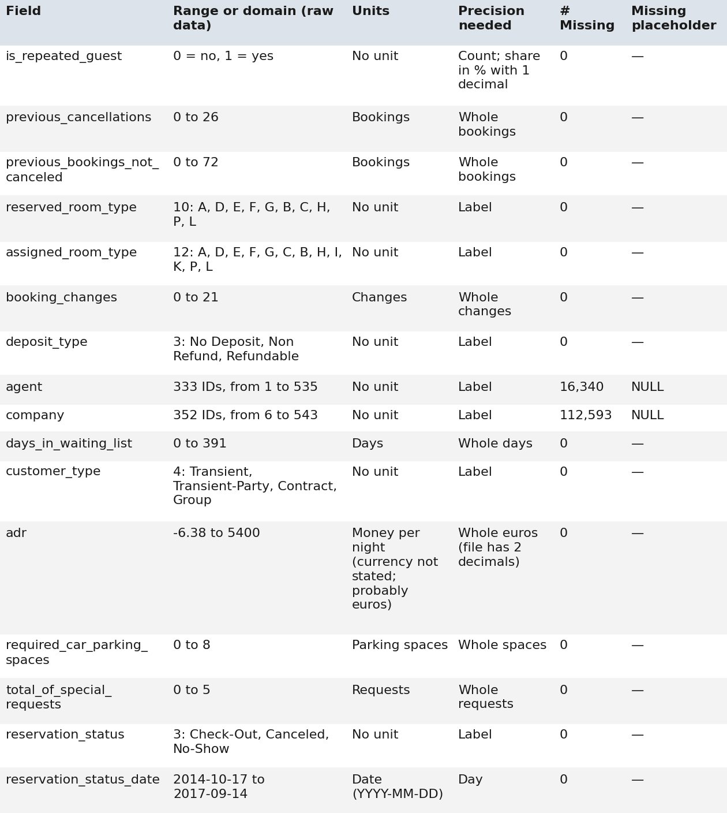

*Figure 4. Data dictionary B (fields 17–32). Source: as Figure 1. Accessible version: data_dictionary.csv.*

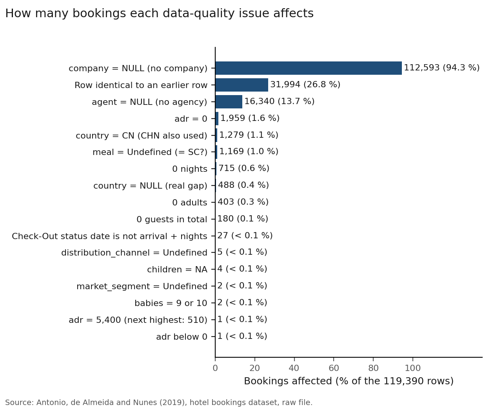

*Figure 5. Bookings affected by each data-quality issue. Source: raw data; code: data_quality.ipynb.*

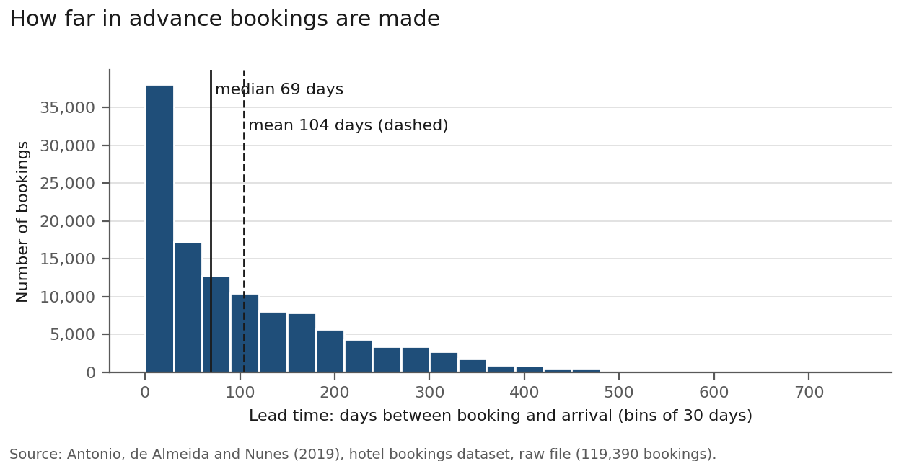

*Figure 6. Lead time distribution with median and mean. Source: raw data; code: distributions_outliers.ipynb.*

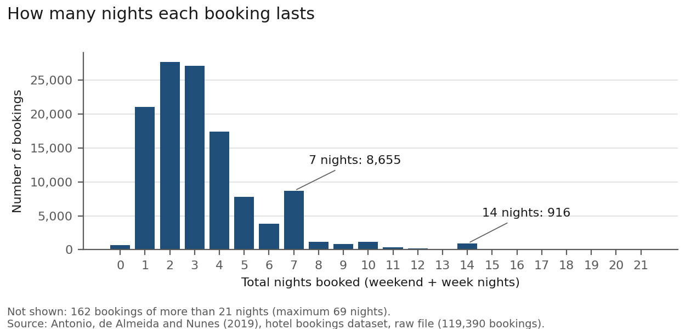

*Figure 7. Nights per booking. Source: as Figure 6.*

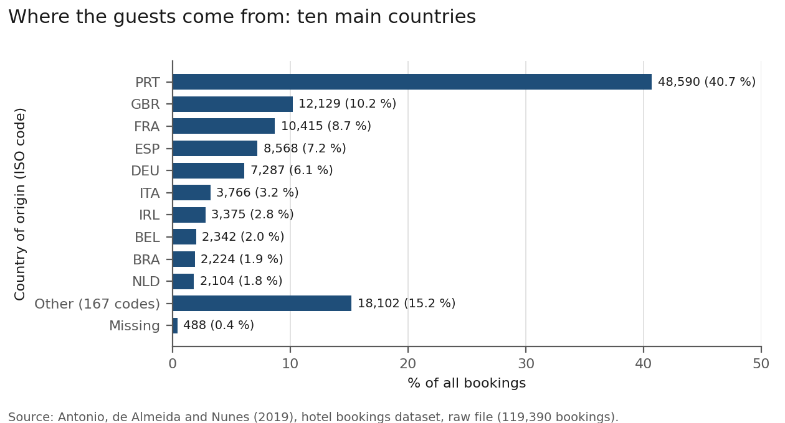

*Figure 8. Country of origin, ten main countries. Source: as Figure 6.*

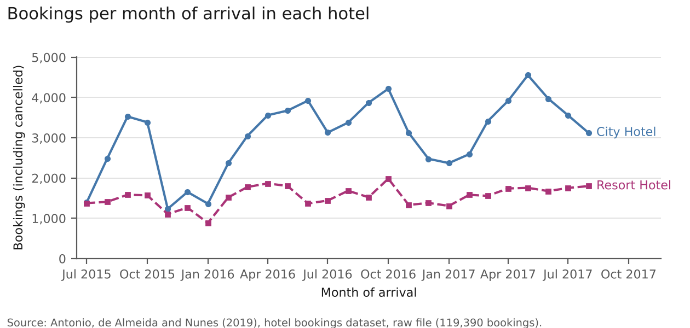

*Figure 9. Bookings per month of arrival by hotel. Source: raw data; code: relationships.ipynb.*

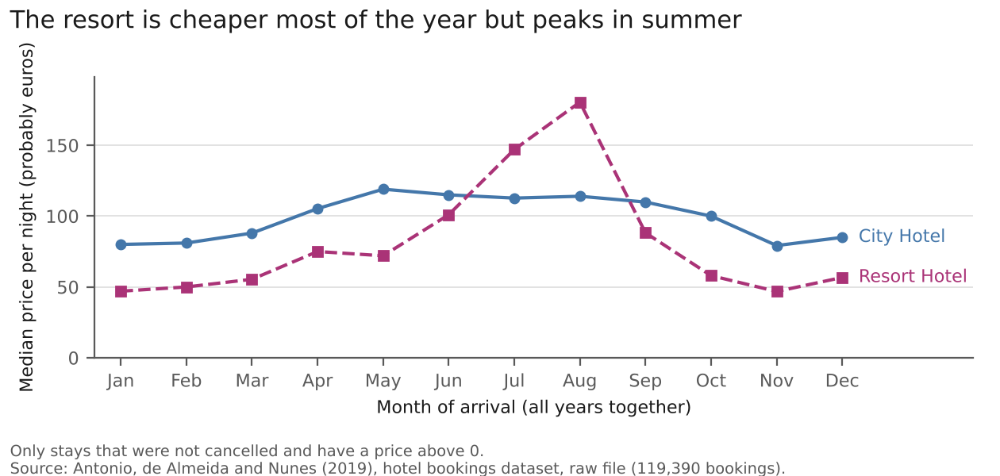

*Figure 10. Median price per night by month and hotel. Source: as Figure 9.*

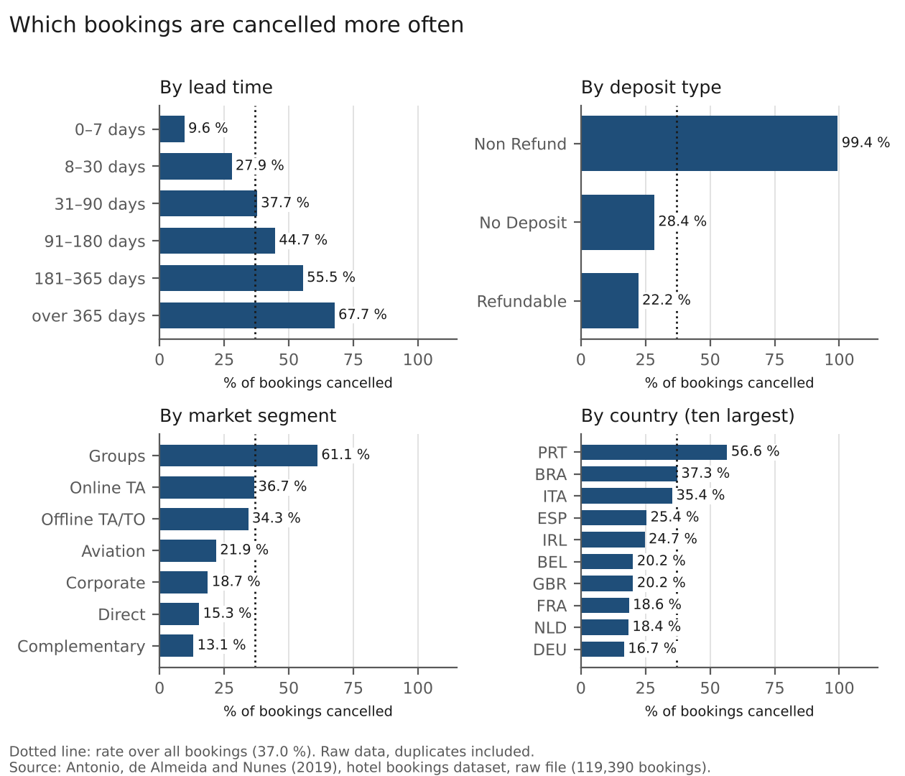

*Figure 11. Cancellation rate by lead time, deposit, segment and country. Source: as Figure 9.*

## Reference

Antonio, N., de Almeida, A. and Nunes, L. (2019). Hotel booking demand datasets. *Data in Brief*, 22, 41–49. https://doi.org/10.1016/j.dib.2018.11.126
