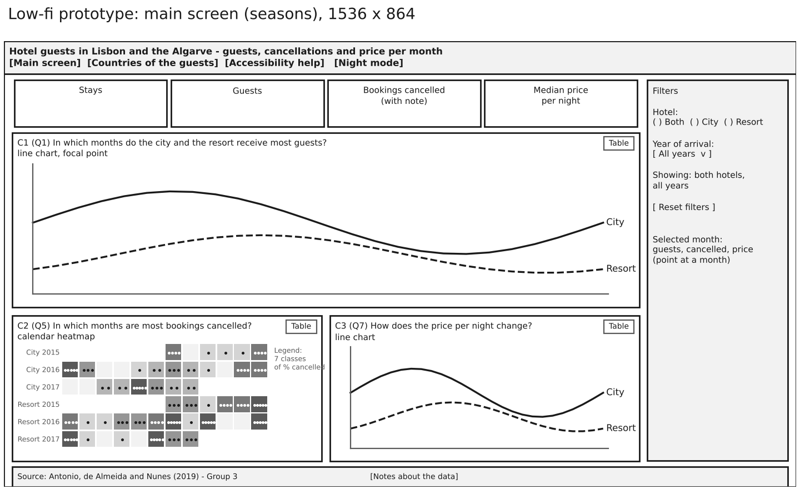
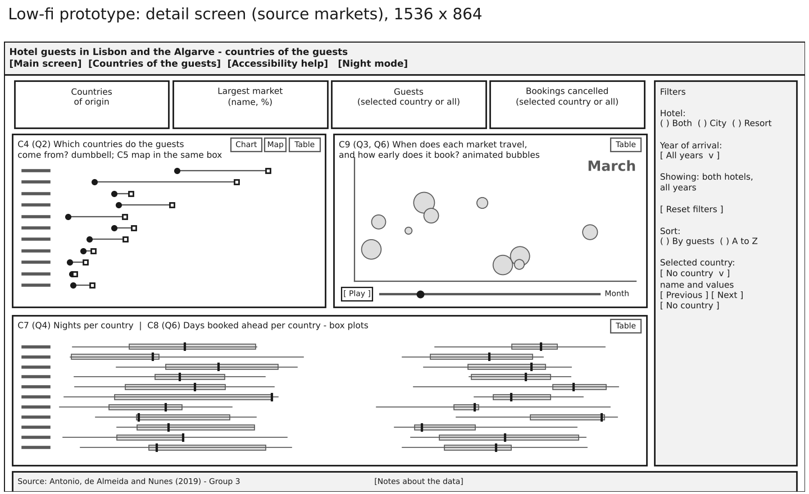
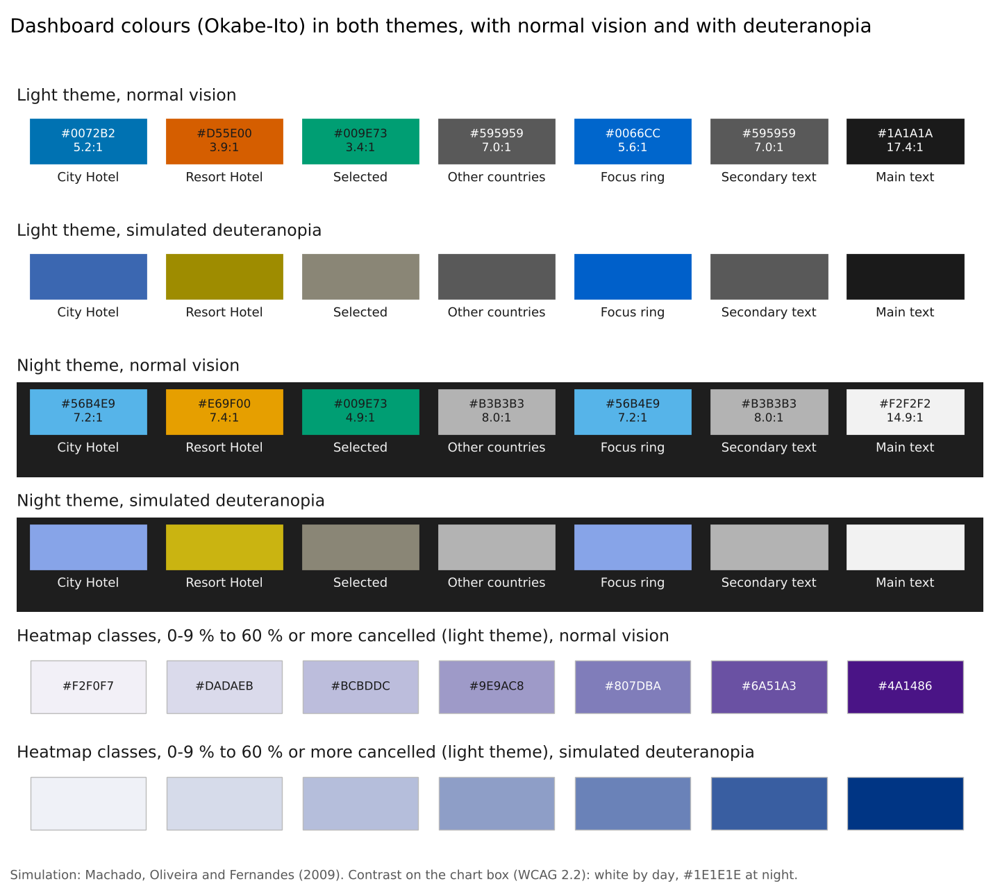

# Part 4. Selection of Charts and Encoding

Group 3, Presentation and Visualization, Infovis2627

## Charts for each question

Each chart answers one of Natalia's questions and was chosen by its function in the Visual Vocabulary; the set was refined after the first build. Every chart passes the DRACO hard rules that apply to it; the map, outside DRACO, follows the course's GeoHandout.

| Question | Function | Chart |
|----------------|----------------|----------------------------------------|
| Q1 busiest months | Evolution over time | C1 line chart of guests per month, July 2015 to August 2017, one line per hotel |
| Q5 cancellations | Evolution over time | C2 calendar heatmap: hotel and year by month, % cancelled in 7 classes |
| Q7 price | Evolution over time | C3 line chart of the median price per night per month |
| Q2 countries | Ranking, spatial | C4 dumbbell of each hotel's share per country, top 10 and Other; C5 map in the same box |
| Q3 season per market | Evolution over time | C9 animated bubbles: one frame per month, size = guests |
| Q4 length of stay | Distribution | C7 box plots of nights per country |
| Q6 booking advance | Distribution | C8 box plots of days booked ahead per country; also the x axis of C9 |

C1 and C3 use the full timeline, as only 2016 is complete. The dumbbell puts both hotels on one row per country, so their gap is read by position, the most accurate channel. Box plots show median and spread, as the data is skewed. In C9 Natalia presses Play to watch the markets move through the year, or picks a month with a slider.

## Encoding, colour and accessibility

We use the Okabe–Ito palette (Figure 3): blue for the City Hotel, vermillion for the Resort, green for the selected country, grey for the others. All pass 3:1 in the light theme and in the night mode, which lightens the same hues. With Natalia's deuteranopia the hotels keep different hues but similar lightness, so each also has a line style, point shape and direct label (Ware G5.11). The heatmap uses seven purple classes, not a gradient, plus dots whose density grows with the class; the selected country also gets a band, a bold label and stripes, and every chart has a Table button. Of the 28 items of our accessibility plan, twelve are solved by this design; the rest belong to Parts 5 and 6.

## Prototype

Both screens share one frame that fits a 16:9 screen without scrolling (Figures 1 and 2): header with links and night mode, four KPIs, a filter panel with the active filters and a reset button, and a footer with the source and data notes. The main screen answers Q1, Q5 and Q7 with C1 as its focal point, taking 46 % of the content area. The detail screen answers Q2, Q3, Q4 and Q6 in three boxes: the dumbbell (or the map, through a Chart / Map switch), the bubbles and the two box plots. No screen shows more than three charts (cognitive accessibility), though no detail box reaches 40 % of the area.

## Figures

*Figure 1. Low-fidelity prototype of the main screen, 1536 × 864 px. Source: our design; code: lowfi_prototype.ipynb.*

*Figure 2. Low-fidelity prototype of the detail screen. Source: as Figure 1.*

*Figure 3. Dashboard colours in both themes, with normal vision and simulated deuteranopia. Source: encoding_checks.ipynb.*
