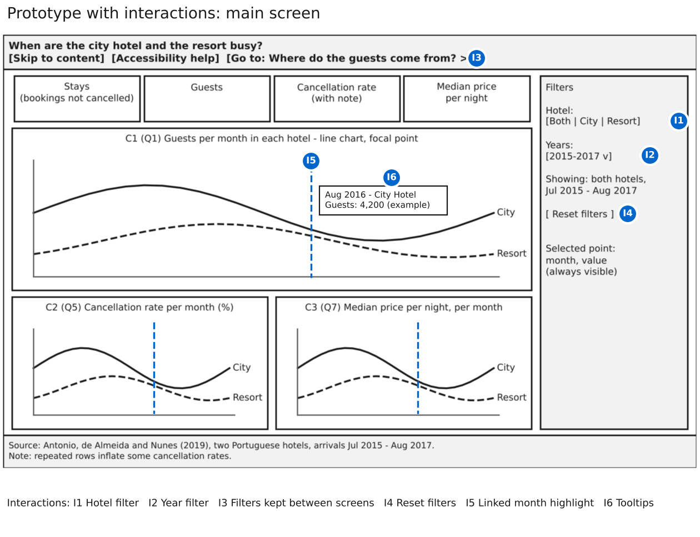

# Part 5. Interaction Planning

Group 3, Presentation and Visualization, Infovis2627

## Principles

Interaction lets Natalia choose what to see, but every action has a cognitive cost. We added only interactions that serve her seven questions, followed Shneiderman's mantra and gave each one a keyboard equivalent. Both screens open with data visible: both hotels, the whole period and no country selected. Zoom, pan and drag were rejected because no chart shows more than 26 months or 12 countries.

| # | Interaction | Course type | Mantra step |
|----|---------------------------|--------------------------|----------------|
| I1 | Hotel filter | Manipulation: filter | Zoom and filter |
| I2 | Year filter | Manipulation: filter | Zoom and filter |
| I3 | Filters kept between screens | Exploration: navigation | Overview first |
| I4 | Reset filters | Manipulation: filter | Zoom and filter |
| I5 | Linked month highlight | Problem solving: linked views | Details on demand |
| I6 | Tooltips | Problem solving: details on demand | Details on demand |
| I7 | Select a country | Problem solving: linked views | Details on demand |
| I8 | Chart / Map switch | Exploration: change of view | Overview first |
| I9 | Sort toggle | Manipulation: order | Zoom and filter |
| I10 | Play the year | Exploration: animation | Overview first |
| I11 | Table view | Problem solving: details on demand | Details on demand |
| I12 | Night mode | Manipulation: customisation |  |

## Interactions between charts

The hotel and year filters (I1, I2) act on all the KPIs and charts of a screen, and the link to the other screen carries them (I3). The year labels name the partial years, "2015 (Jul–Dec)" and "2017 (Jan–Aug)". A reset button (I4) is always visible. On the main screen, pointing at a month or reaching it with the arrow keys marks it in all of the charts (I5): a rule in the two line charts and an outline in the calendar heatmap, with its values in the filter panel. On the detail screen, clicking a dot, bubble, box or country, or using the list or Previous and Next, selects a country in every chart and KPI (I7); a second click or the "No country" button clears it. A country outside the top 10 is added at the top of the country charts. The selection is shown by a band, a bold label, an outline and stripes, never by colour alone.

## Interactions inside each chart

Tooltips (I6) give exact values with units, also for a mark reached with the keyboard. The sort toggle (I9) orders countries by number of guests or alphabetically. The Chart / Map switch (I8) shows the map in the dumbbell's box, keeping three charts visible. Play (I10) moves the bubbles from January to December; it never starts by itself and has Pause and a month slider. Each chart has a Table button (I11), and night mode (I12) that darkens both screens.

## Feasibility

Every chart feature was built in a small Vega-Altair test and compiled to SVG; the switch, tables, reset and links need only HTML. Because each chart is embedded separately, with its own alternative text, selections are passed between charts with a few lines of JavaScript, built and tested in Part 6. Figures 1 and 2 show where each interaction appears.

## Figures

*Figure 1. Main screen with interactions I1 to I6, I11 and I12. Source: our design; code: prototype_interactions.ipynb.*

*Figure 2. Detail screen with interactions I1 to I4 and I6 to I12. Source: our design; code: prototype_interactions.ipynb.*
