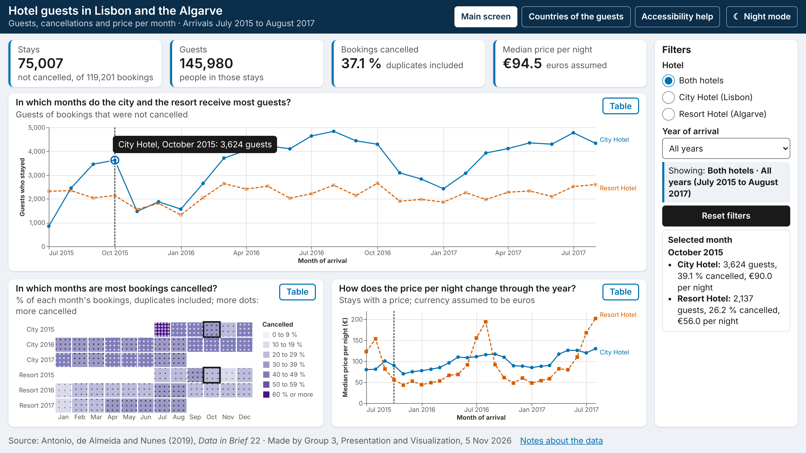
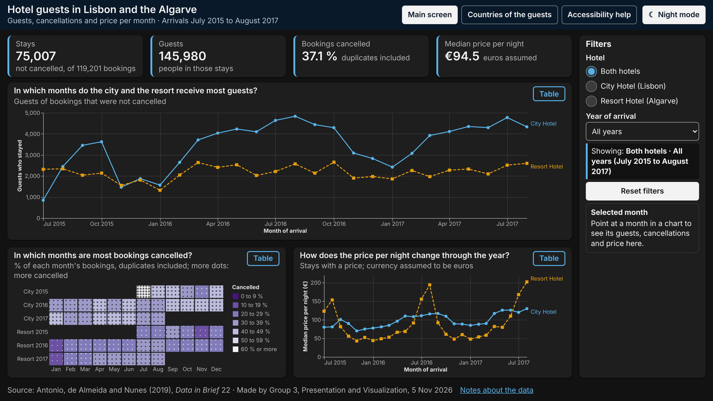
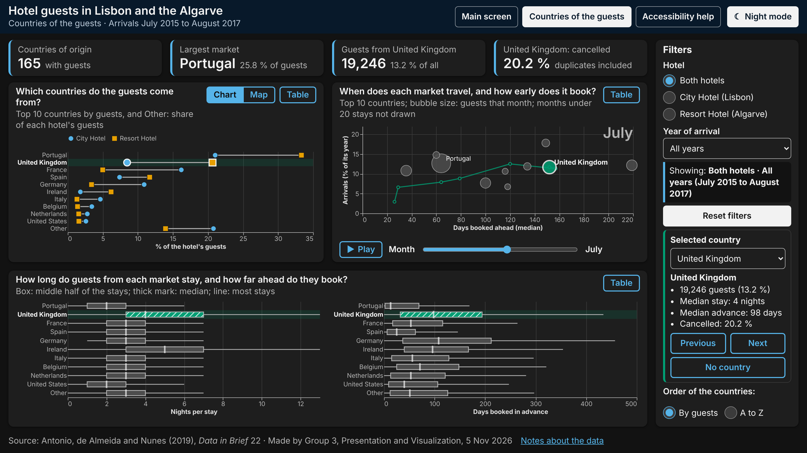

# Part 6. Implementation and Delivery

Group 3, Presentation and Visualization, Infovis2627

## How to open the dashboard

Open the folder `Part 6 - Implementation and Delivery/dashboard/` and double-click `index.html`, or open it in any web browser or in VS Code. No server, no command and no internet connection are needed: the data, the chart specifications and the Vega libraries are all local files in that folder. The dashboard is made for a computer screen in full-screen mode (F11): on a 16:9 screen of 1536 × 864 px or larger, each screen fits without scrolling. The link "Countries of the guests" leads to the detail screen, "Accessibility help" to `accessibility.html`, and "Night mode" switches to a dark theme.

## What was built

The two screens planned in Parts 4 and 5 for Natalia: the main screen (Figures 1 to 3) shows guests, cancellations and price per month; the detail screen (Figures 4 and 5) shows where the guests come from, when each market travels, how long it stays and how early it books. After a first version, the students refined it to fit one 16:9 screen, use the Okabe–Ito colours with a night mode, and add more varied charts: a calendar heatmap, a dumbbell chart, animated bubbles and box plots.

## Implementation decisions

`code/build_dashboard.ipynb` aggregates the cleaned bookings with pandas into six small tables in `data/processed/`, keeping the hotel, year, month and country so that every filter and selection still works; medians are computed in advance for each filter combination. The country charts count guests of stays, not bookings, because Natalia plans for people who travel.

The charts are built with Vega-Altair and drawn as SVG. The pages are plain HTML, CSS and JavaScript around them, because the keyboard navigation and announcements the accessibility skill requires cannot be made with Altair alone. Browsers block reading a local `.json` file from a page opened by double-click, so the data and the chart specifications are written as `data.js` and `specs.js`. Besides the files listed in `architecture.md`, the screens share `dashboard.css` and `dashboard.js`, and `theme.js` sets the night mode, which swaps each colour of the charts for a lighter or darker one.

All twelve interactions of Part 5 were built: filters with reset, the linked month, tooltips, country selection, the Chart / Map switch, sorting, Play, a Table button per chart and the night mode.

## Accessibility and review

Every chart can be used with the keyboard, has a text alternative and a data table, and never shows a value by colour alone (line styles, the heatmap dots, the stripes of the selected country). `code/browser_checks.ipynb` tested both screens in a browser, in both themes and at 200 % zoom, and `code/final_review.ipynb` reviewed the DRACO, data-viz, notebook and WCAG checklists: they are met, except that the data points are smaller than 24 px, the heatmap shows its values by colour rather than position, and no detail chart reaches 40 % of the area. No real screen reader was used. In the data, 26.8 % of the rows are duplicates and are kept, so the key figures say "duplicates included".

## Figures

*Figure 1. Main screen at first load, both hotels and all years, 1536 × 864 px. Source: dashboard/index.html; screenshot: final_review.ipynb.*

*Figure 2. Main screen used with the keyboard, with the focus ring, the value box and the linked month. Source: as Figure 1.*

*Figure 3. Main screen in night mode. Source: as Figure 1.*

*Figure 4. Detail screen at first load, with no country selected. Source: dashboard/detail.html; screenshot: final_review.ipynb.*

*Figure 5. Detail screen in night mode, United Kingdom selected, bubbles for July. Source: as Figure 4.*
